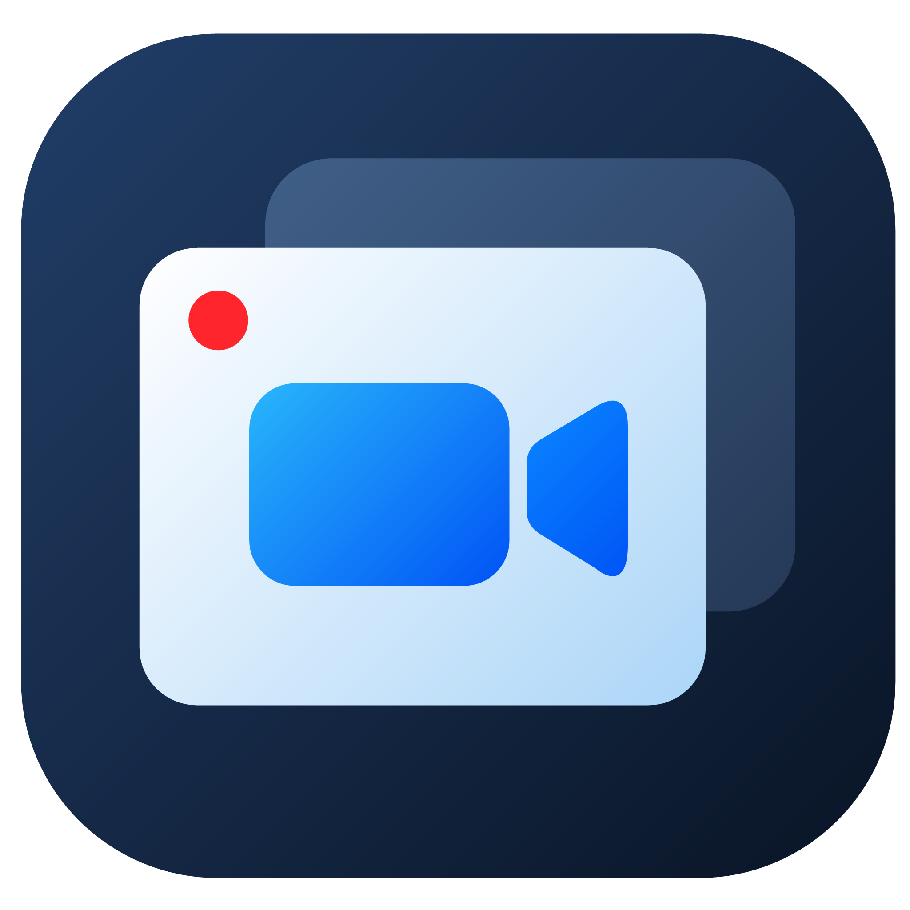

<p align="center">
  
</p>

<h1 align="center">Screencast</h1>

<p align="center">A compact, native screen recorder for Windows 11.</p>

<p align="center">
  <a href="https://github.com/sanderstripa/screencast/releases/latest">Download</a> ·
  <a href="https://github.com/sanderstripa/screencast/issues">Report an issue</a> ·
  <a href="VALIDATION.md">Validation</a>
</p>

Screencast records a monitor or an individual window to MP4, with independent system audio and microphone controls. Add a movable webcam circle, adjust noise suppression, and change your camera background without leaving the recording window.

Built with **C++20 and Win32**, using Windows capture, audio and encoding APIs. The core application does not require an external runtime.

## Features

- **Monitor and window capture.** Choose any detected monitor or an individual window.
- **Independent audio sources.** Record system audio, audio from a selected application/process, microphone audio, or a combination. System and microphone volume sliders range from 0 to 200%.
- **Live recording controls.** Turn the microphone and webcam on or off during recording. Switch between mirrored and ordinary camera orientation without restarting.
- **Movable webcam circle.** Start in any of the four corners, then drag the circle on the desktop. Its movement is reflected smoothly in the recording; it also appears in screenshots.
- **Adjustable software noise suppression.** Enable it for the microphone and set its intensity from 0 to 100%.
- **Camera background effects.** Blur the real background or choose a solid color, gradient, neutral interior, or your own image. Effects run locally using an optional foreground model.
- **MP4 output.** H.264 video with optional AAC audio. Hardware encoding is preferred when available, with a software fallback.
- **Light, dark and system themes.** A custom window header, compact CONNECT UI controls, Montserrat typography, and no vertical scrolling. Light and dark colors now match CONNECT VPN, as requested.
- **One application instance.** Launching Screencast again restores the existing window.

The application and installer support **Russian and English**. Open **Settings** to choose the application language, System/Light/Dark theme, and default recording folder. Recording controls remain on the main screen.

## Download and install

Get the latest version from [GitHub Releases](https://github.com/sanderstripa/screencast/releases/latest):

| File | Use |
| --- | --- |
| `Screencast-Setup-x64.exe` | Install for the current user, with optional desktop and Start menu shortcuts and an uninstaller. Administrator privileges are not required. |
| `Screencast-Windows-x64.zip` | Portable version. Extract the entire archive and run `Screencast.exe`. Keep the accompanying assets and scripts. |

**Requirements:** Windows 11 x64. Windows N editions need the Media Feature Pack. A microphone and webcam are optional.

## Record your screen

1. Choose a monitor or window. Use **Refresh** to update the list of sources and devices.
2. Select no output audio, system audio, or audio from an application/process. Audio selection is independent of the video source.
3. Enable the microphone if needed, set the two volume sliders, and adjust noise suppression.
4. Optionally enable the webcam, choose its corner and mirror setting, and select a background effect.
5. Choose an MP4 destination and start recording. The preview appears once recording starts. You can toggle the microphone and webcam, adjust volume, change mirroring, and move the webcam circle while recording.
6. Stop recording to finalize the MP4. Closing the application also finalizes an active recording first.

Existing files are not overwritten. Recording uses a unique `.partial.mp4` file, which is renamed after successful finalization. If recording fails, Screencast attempts to preserve the available portion and reports its location. A sudden power loss can leave an MP4 unfinished.

## Optional camera background model

Use the download button in the application to install the background effects model once, approximately **15 MB**. A failed download can be retried from the same button.

Alternatively, run this command from the extracted portable application folder:

```powershell
./scripts/setup-background.ps1
```

For an application built from source:

```powershell
./scripts/setup-background.ps1 -AppDirectory ./dist/Screencast
```

The [Robust Video Matting](https://github.com/PeterL1n/RobustVideoMatting) model runs locally through Windows ML; camera frames are not uploaded. GPU inference is preferred, with a CPU fallback. Performance depends on the hardware. The model is downloaded separately and is licensed under GPL-3.0; see [Third-party components](THIRD_PARTY.md).

## Build from source

Install **Visual Studio 2022 or Build Tools** with the Desktop development with C++ workload, **Windows SDK 10.0.22000 or newer**, and **CMake 3.24 or newer**. Use a developer PowerShell session with the MSVC toolchain available.

```powershell
git clone https://github.com/sanderstripa/screencast.git
cd screencast
./scripts/build.ps1
./dist/Screencast/Screencast.exe
```

The build script compiles the application, runs the core tests, and packages the portable version. The [Windows workflow](.github/workflows/windows.yml) also builds the native installer and publishes tagged releases.

## Current limitations

- Video is recorded at **30 FPS in SDR**. Output dimensions are fixed when recording starts; window resizing preserves aspect ratio with black padding. HDR and resolutions above 4K require further validation.
- A minimized capture window may stop producing new frames. Protected content can appear black.
- Application audio capture includes a process and its child processes, rather than an individual browser tab. Use a separate application or process tree to isolate a source.
- Selected devices remain fixed during a recording. Default-device changes are not picked up automatically; start a new recording to change devices. Source closure, audio-process exit, and device or disk failures end recording with a message.
- Software noise suppression works best on steady fan noise and hiss. Keyboard impacts and background voices may remain. Hardware microphone processing is configured through Windows or the device manufacturer's tools.
- Built-in background effects can be changed during recording; a custom image must be chosen beforehand.
- Theme, language, and the recording folder are saved between sessions. Other recording settings are not yet persisted. Hotkeys and detailed encoding controls are not yet available.

## Validation and project notes

Automated Windows checks cover audio mixing and suppression, decoded MP4 output, webcam composition and live toggles, foreground matting, themes and dropdowns, installer behavior, icon extraction, and repeated launches. Synthetic checks do not replace testing with physical devices.

See [validation results](VALIDATION.md), [manual test scenarios](tests/MANUAL.md), and [third-party components and licensing notes](THIRD_PARTY.md). The application does not yet have a declared distribution license.

Settings uses the approved [CONNECT settings icon #8](assets/CONNECT-settings-08.svg), imported unchanged from the CONNECT UI reference branch. Its original vector contours are rendered without a background tile or focus frame.

Appearance settings use CONNECT's RU/EN chips and monitor/sun/moon theme buttons. Window actions use the same vector icons with no hover background; the main window opts into Windows 11 rounded corners.
